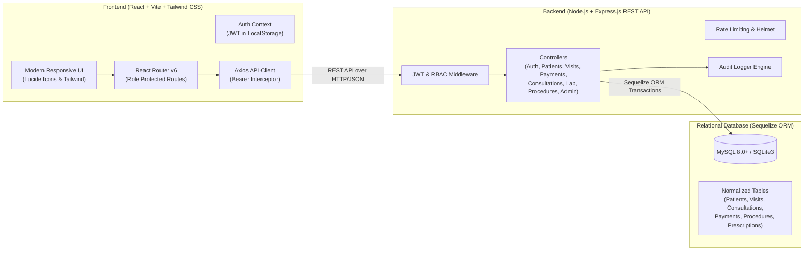
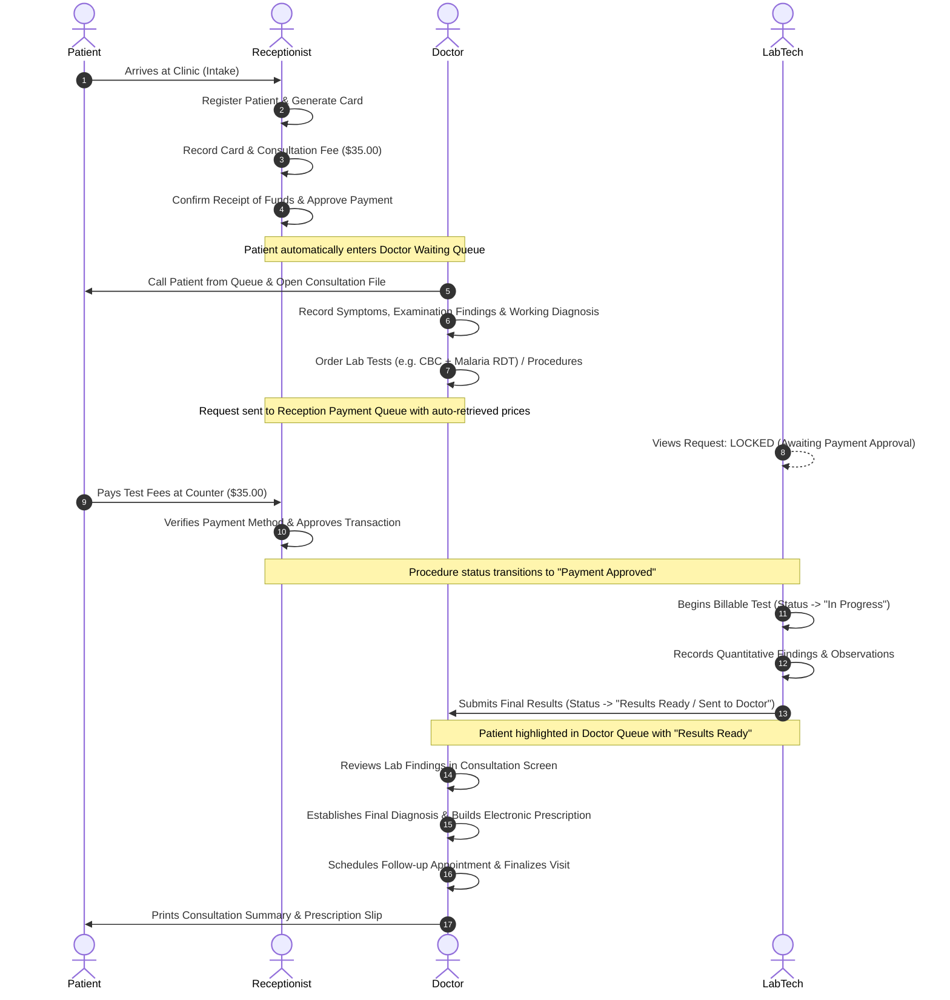

# Tena Specialty Clinic Management System (CMS)

A full-stack, responsive, production-ready **Clinic Management System** built with **React (Vite) + Tailwind CSS**, **Node.js (Express)**, and **Sequelize ORM** (supporting **MySQL** and **SQLite**).

Designed for small-to-medium healthcare clinics and diagnostic centers, this system digitizes the entire patient lifecycle—from receptionist intake and fee collection, to doctor consultation, laboratory test ordering with payment enforcement, radiologic procedure processing, electronic prescriptions, and administrative revenue governance.

---

## 1. System Architecture & Tech Stack



### Technology Highlights
- **Frontend**: React 18 with Vite, Tailwind CSS, React Router v6, Axios, Lucide React icons.
- **Backend**: Node.js, Express.js, JWT (`jsonwebtoken`), `bcryptjs`, `helmet`, `cors`, `express-rate-limit`, `morgan`.
- **Database**: Sequelize ORM with dual-dialect capability:
  - **MySQL** (configured via `.env` using `mysql2`)
  - **SQLite** (file-based out-of-the-box fallback at `database/clinic.sqlite` for instant zero-config testing)
- **Security & Reliability**:
  - Secure bcrypt password hashing.
  - Role-Based Access Control (RBAC) enforced on every endpoint.
  - Atomic database transactions on payment verifications and patient state updates.
  - Comprehensive immutable audit logging in `audit_logs` table.
  - Protection against unauthorized price alterations and billable laboratory testing before fee receipt.

---

## 2. User Roles & Authentication

The system uses secure email/password authentication. Staff accounts are managed permanently by the Administrator:

| Role | Email | Password | Primary Functions |
| :--- | :--- | :--- | :--- |
| **Administrator** | `admin@clinic.com` | `Admin@123` | Financial dashboards, executive reports, staff user accounts, service pricing, clinic settings, audit logs. |
| **Receptionist** | `reception@clinic.com` | `Recept@123` | Patient registration with 10-day card fee validation, daily ETB revenue tracking (Cash, Telebirr, Bank), queue management. |
| **Doctor** | `doctor@clinic.com` | `Doctor@123` | Weekly patient counter, disease classification by age group, consultations, e-prescriptions, procedure ordering. |
| **Lab Technician** | `lab@clinic.com` | `Lab@123` | Billable diagnostics queue, test analytics, result entry, automated physician notification. |

> **Security Note**: Public shortcuts and demo autofill buttons are disabled on the login screen to prevent credential exposure. All authenticated staff can securely update their credentials at any time via the **Password** modal in the top navigation bar.

---

## 3. Key Features & Business Logic

### 1. Role-Based Reporting & Analytics
- **Doctor Analytics**:
  - Weekly consultation tracking showing patient volume week-over-week.
  - Disease classification broken down into 4 demographic age cohorts:
    - **Pediatric** (Age 0–14)
    - **Youth** (Age 15–24)
    - **Adults** (Age 25–54)
    - **Seniors** (Age 55+)
- **Reception Analytics**:
  - **Dedicated Daily Revenue Tracker**: Real-time tracking of today's collected revenue in Birr (ETB) categorized by payment method (**Cash**, **Telebirr**, **Bank Transfer**), transaction count, and fee type (Card, Consultation, Diagnostic). Searchable itemized receipt audit table.
  - **Weekly Performance Overview**: 7-day comparative revenue and patient footfall trends.
- **Laboratory Analytics**:
  - Weekly and daily test volume metrics, completion rates, pending backlogs, and most frequently ordered diagnostic tests.
- **Executive Admin Reporting**:
  - Centralized multi-departmental reporting dashboard with cross-functional metrics and date-range filtering.

### 2. Patient Card Fee & 10-Day Expiry Logic
- Standard patient card fee: **150.00 ETB**.
- **10-Day Free Window**: A patient's card fee remains valid for **10 days** from their last payment date.
- **Automatic Expiry & Renewal**:
  - If a patient returns within 10 days of their last card fee payment, the card fee is **waived/free (0.00 ETB)**.
  - If a patient returns after 10 days, the system automatically prompts and charges the standard card renewal fee (150.00 ETB).
  - Approving a renewal payment dynamically resets the patient's card fee validity timer.

### 3. Secure Authentication & Password Management
- Clean, confidential login interface requiring registered email and password.
- In-app **Change Password** feature for authenticated users with current password validation and secure bcrypt hashing.

### 4. Permanent Staff Accounts & Data Persistence
- Admin-created staff accounts (doctors, lab technicians, receptionists) are permanently preserved in the database.
- Safe database initialization never drops tables or wipes existing user accounts upon server restarts.

---

## 4. Core Clinical & Operational Workflows



### 1. Receptionist Intake & Approval
- Auto-generates standardized patient card numbers: `CLN-YYYY-XXXX` (e.g. `CLN-2026-0001`).
- Dynamically retrieves configured registration and consultation fees from the database.
- Records payment method (Cash, Bank Transfer, POS Card, Mobile Money, Insurance).
- **Payment Verification Lock**: A patient only transitions from `registered` to `waiting_consultation` once the receptionist physically confirms and approves the payment.

### 2. Doctor Consultation Workspace
- Demographic banner with prominent **Drug Allergy Alerts**.
- Structured clinical encounter recording: Presenting Symptoms, Physical Examination, Working Diagnosis, Treatment Plan, and Notes.
- **Diagnostic Procedure Ordering**: Auto-fetches live catalog prices (CBC, Fasting Blood Sugar, Lipid Panel, Urinalysis, Abdominal Ultrasound, Chest X-Ray, ECG).
- **Real-Time Tracker**: Doctor monitors each requested test through color-coded statuses (`Awaiting Payment`, `Payment Approved`, `In Progress`, `Results Ready`).
- **Electronic Prescription Builder**: Add multiple medication items with specific dosage, frequency (e.g. TDS), duration (e.g. 5 days), route, quantity, and instructions.
- Schedules calendar follow-up appointments.

### 3. Laboratory Diagnostics & Procedures
- **Strict Billable Enforcement**: Tests in `awaiting_payment` status cannot be initiated by laboratory technicians.
- Once receptionist approves payment, technician clicks "Start Test", runs specimens, enters findings and observations, and clicks "Submit Results to Doctor".
- Updates visit status to `results_ready`, immediately alerting the attending physician.

### 4. Radiology (Ultrasound & X-Ray) & Minor Procedures
- Dedicated procedures dashboard for imaging staff to review ultrasound scan requests, chest/extremity X-rays, and minor surgical procedures.
- Findings and radiologist reports are saved and linked to the patient's record.

### 5. Administrator Governance & Analytics
- Comprehensive revenue reports (daily, monthly, revenue by payment method, revenue by service category).
- Service & pricing management: full price customization across all categories. Non-admins cannot alter prices.
- User management: create staff accounts, assign roles, toggle active status, and reset passwords.
- Immutable compliance audit logs recording timestamps, user IDs, action names, and IP addresses.

---

## 4. Project Directory Structure

```text
clinic-management-system/
├── client/                              # Frontend React + Vite Application
│   ├── src/
│   │   ├── api/
│   │   │   └── client.js                # Axios instance with Bearer interceptors
│   │   ├── context/
│   │   │   └── AuthContext.jsx          # User session, JWT state, login, logout
│   │   ├── components/
│   │   │   └── common/
│   │   │       ├── Navbar.jsx           # Responsive header with branding & user badge
│   │   │       ├── Sidebar.jsx          # Role-based collapsible navigation
│   │   │       ├── StatusBadge.jsx      # Standardized status pills
│   │   │       ├── Modal.jsx            # Accessible dialog modal
│   │   │       ├── LoadingSpinner.jsx   # Loading state spinner
│   │   │       └── ProtectedRoute.jsx   # Role-guarded route wrapper
│   │   ├── pages/
│   │   │   ├── LoginPage.jsx            # Login with 1-click Demo credentials
│   │   │   ├── reception/               # Receptionist Dashboard, Registration, Payments
│   │   │   ├── doctor/                  # Doctor Dashboard, Queue, Consultation Workspace
│   │   │   ├── laboratory/              # Lab Workspace, Test Results Entry, Reports
│   │   │   ├── procedures/              # Ultrasound, X-Ray & Procedure Queues
│   │   │   └── admin/                   # Financial Dashboards, Services, Users, Audit
│   │   ├── App.jsx                      # Router configuration
│   │   ├── main.jsx                     # Vite React entry point
│   │   └── index.css                    # Tailwind CSS & Print styles
│   ├── package.json
│   ├── vite.config.js                   # Vite config with /api proxy to localhost:5000
│   └── tailwind.config.js
│
├── server/                              # Backend Express.js REST API
│   ├── src/
│   │   ├── config/
│   │   │   ├── database.js              # Sequelize dual MySQL / SQLite config
│   │   │   └── constants.js             # User roles, visit, payment & request statuses
│   │   ├── models/
│   │   │   ├── User.js                  # Staff accounts with bcrypt hooks
│   │   │   ├── Patient.js               # Patient demographic & medical records
│   │   │   ├── PatientVisit.js          # Encounters and queue tracking
│   │   │   ├── Service.js               # Service catalog and pricing
│   │   │   ├── Payment.js               # Receipts, amounts paid, payment methods
│   │   │   ├── PaymentAllocation.js     # Links payments to services / procedure requests
│   │   │   ├── Consultation.js          # Doctor examination notes & diagnoses
│   │   │   ├── Diagnosis.js             # Provisional and final diagnosis records
│   │   │   ├── ProcedureRequest.js      # Lab / ultrasound / x-ray test orders
│   │   │   ├── ProcedureRequestItem.js  # Individual test line items
│   │   │   ├── LaboratoryResult.js      # Findings, data, observations & technician
│   │   │   ├── Prescription.js          # Prescription headers
│   │   │   ├── PrescriptionItem.js      # Dosage, frequency, duration, route, quantity
│   │   │   ├── Appointment.js           # Follow-up appointment scheduling
│   │   │   ├── AuditLog.js              # Security & event audit logs
│   │   │   ├── ClinicSetting.js         # Facility branding, currency, receipt footer
│   │   │   └── index.js                 # Sequelize model associations
│   │   ├── middleware/
│   │   │   ├── auth.js                  # JWT token verification
│   │   │   ├── rbac.js                  # Role-based authorization
│   │   │   ├── auditLogger.js           # Audit event logger helper
│   │   │   └── errorHandler.js          # Centralized error handler
│   │   ├── controllers/                 # REST business logic controllers
│   │   ├── routes/                      # Express route endpoints
│   │   ├── database/
│   │   │   └── seeders/
│   │   │       └── seed.js              # Database seeder with realistic clinical data
│   │   ├── app.js                       # Express app configuration & middleware
│   │   └── server.js                    # Server startup script
│   ├── tests/
│   │   └── api.test.js                  # Integration test suite (15 automated tests)
│   ├── .env.example
│   └── package.json
│
├── database/
│   ├── schema.sql                       # Clean MySQL schema dump
│   └── clinic.sqlite                    # SQLite database file (when running in SQLite mode)
│
├── .env.example                         # Root environment example
├── package.json                         # Root package manager scripts
└── README.md                            # Comprehensive documentation
```

---

## 5. Database Schema & Setup

### Option A: Running with SQLite (Instant, Zero Setup)
The application is pre-configured to use SQLite by default (`DB_DIALECT=sqlite`). The database is stored at `database/clinic.sqlite`. No external database server installation is needed to immediately run and test the complete system.

### Option B: Running with MySQL
1. Create a MySQL database:
   ```sql
   CREATE DATABASE clinic_db CHARACTER SET utf8mb4 COLLATE utf8mb4_unicode_ci;
   ```
2. (Optional) You can import the raw SQL schema located at `database/schema.sql`:
   ```bash
   mysql -u root -p clinic_db < database/schema.sql
   ```
3. In `server/.env`, set:
   ```env
   DB_DIALECT=mysql
   DB_HOST=localhost
   DB_PORT=3306
   DB_NAME=clinic_db
   DB_USER=root
   DB_PASSWORD=your_mysql_password
   ```
4. Run the database seeder to create tables and seed demo accounts:
   ```bash
   cd server
   npm run seed
   ```

---

## 6. REST API Endpoint Reference

### Authentication
- `POST /api/auth/login` - Authenticate staff user; returns JWT token & role.
- `POST /api/auth/logout` - Invalidate session & write audit log.
- `GET /api/auth/me` - Retrieve current authenticated user profile.

### Patients & Visits
- `POST /api/patients` - Register new patient, generate card number, create visit and initial payment record.
- `GET /api/patients` - Search and list patients (with pagination and query filters).
- `GET /api/patients/:id` - Get patient file, past visits, and medical history.
- `PUT /api/patients/:id` - Update patient demographics or medical notes.
- `GET /api/patients/:id/medical-history` - Consolidated past diagnoses, lab results, prescriptions.
- `POST /api/visits` - Register return visit for existing patient.
- `GET /api/visits` - List active patient visits / queues.
- `PUT /api/visits/:id/status` - Transition visit status.

### Consultations
- `GET /api/consultations/queue` - Retrieve waiting queue for doctor.
- `POST /api/consultations` - Start or save draft consultation encounter.
- `GET /api/consultations/:id` - Get consultation details with ordered tests and prescriptions.
- `PUT /api/consultations/:id` - Update clinical findings, symptoms, and diagnosis.
- `POST /api/consultations/:id/complete` - Finalize consultation, record prescriptions, schedule follow-up, and complete visit.

### Diagnostic Procedures & Laboratory
- `POST /api/procedure-requests` - Doctor orders lab/imaging services (auto-fetches prices; sends to payment queue).
- `GET /api/procedure-requests` - List procedure requests filtered by category and status.
- `PUT /api/procedure-requests/:id/status` - Update status (e.g. cancel).
- `GET /api/laboratory/requests` - Laboratory department queue (awaiting payment, approved, in-progress, completed).
- `POST /api/laboratory/start/:id` - Begin billable test (strictly blocked if unpaid).
- `POST /api/laboratory/results` - Submit findings and observations; automatically notifies doctor.
- `GET /api/laboratory/results/:id` - Get printable diagnostic report.

### Payments & Approvals
- `GET /api/payments` - List payments (filter by `pending` or `approved`).
- `GET /api/payments/:id` - Get receipt details with itemized allocations.
- `POST /api/payments/:id/approve` - Receptionist verifies and approves payment transactionally; routes patient to doctor or diagnostic departments.

### Services & Pricing (Administrator Only)
- `GET /api/services` - List active clinic services and fee schedules.
- `POST /api/services` - Create new clinic service.
- `PUT /api/services/:id` - Update service fee or name.
- `DELETE /api/services/:id` - Soft deactivate service.

### Administration & Reports
- `GET /api/reports/dashboard` - Executive KPI metrics across all four roles.
- `GET /api/reports/audit-logs` - Audit trail of system events.
- `GET /api/users` - List staff accounts.
- `POST /api/users` - Create new staff account.
- `PUT /api/users/:id` - Edit user role, toggle status, or reset password.
- `GET /api/settings` - Clinic information and receipt notes.
- `PUT /api/settings` - Update clinic information.

---

## 7. How to Run the Application Locally

### Prerequisites
- Node.js (v18.0.0 or higher)
- npm (v9.0.0 or higher)

### Step 1: Install Dependencies
Open a terminal in the root folder `clinic-management-system`:

```bash
# Install server dependencies
cd server
npm install

# Install client dependencies
cd ../client
npm install
```

### Step 2: Seed the Database
Seed demo accounts, clinic services, standard prices, and realistic patient journeys:

```bash
cd server
npm run seed
```

### Step 3: Run the Automated Tests
Verify all 15 integration tests covering authentication, role-based authorization, patient registration, payment approvals, procedure ordering, and laboratory billable enforcement:

```bash
cd server
npm test
```

### Step 4: Start the Backend API Server
In the `server` folder:

```bash
npm start
# Or for live auto-reload during development:
npm run dev
```
The backend API will run at `http://localhost:5000`. Health check: `http://localhost:5000/api/health`.

### Step 5: Start the Frontend Application
In a new terminal, navigate to the `client` folder:

```bash
cd client
npm run dev
```
Open your browser and navigate to `http://localhost:5173`.

### Step 6: Log In with Any Role
On the login screen (`http://localhost:5173/login`), type your registered credentials:
- **Receptionist**: `reception@clinic.com` / `Recept@123`
- **Doctor**: `doctor@clinic.com` / `Doctor@123`
- **Lab Technician**: `lab@clinic.com` / `Lab@123`
- **Administrator**: `admin@clinic.com` / `Admin@123`

---

## 8. Verification & Test Walkthrough

To verify the end-to-end patient journey:
1. Log in as **Receptionist** (`reception@clinic.com`).
2. Click **Register Patient**: enter name "Alice Walker", phone "555-0199", choose Consultation Type.
3. Leave "Confirm Receipt & Approve Payment Immediately" unchecked to test deferred payment, or check it to approve immediately.
4. Go to **Payment Approvals**: view pending registration fee and click **Verify & Approve**. The patient now moves to the Doctor's queue.
5. Log out and log in as **Doctor** (`doctor@clinic.com`).
6. Go to **Waiting Patients Queue**: Alice Walker is waiting. Click **Consult Now**.
7. Enter symptoms, examination findings, and diagnosis.
8. Go to **Order Diagnostics**: choose Complete Blood Count (CBC) and Malaria RDT. Click **Send Request to Reception Payment Queue**. Notice the status badge shows `Awaiting Payment`.
9. Log in as **Lab Technician** (`lab@clinic.com`).
10. Notice the test for Alice Walker is marked **Locked (Unpaid)**. Clicking "Start Test" is blocked with a security alert.
11. Log back in as **Receptionist**: open **Payments & Approvals**, find the procedure request fee, and click **Verify & Approve**.
12. Return to **Lab Technician**: the test is now **Payment Approved (Ready)**! Click **Start Test** -> **Record Results**, enter parameter values, and click **Submit Results to Doctor**.
13. Return to **Doctor**: open consultation, view the completed lab results, prescribe medications in the Prescription Builder, schedule a follow-up appointment, and click **Finalize & Complete Consultation**!

---

## 9. License

This project is licensed under the MIT License.
